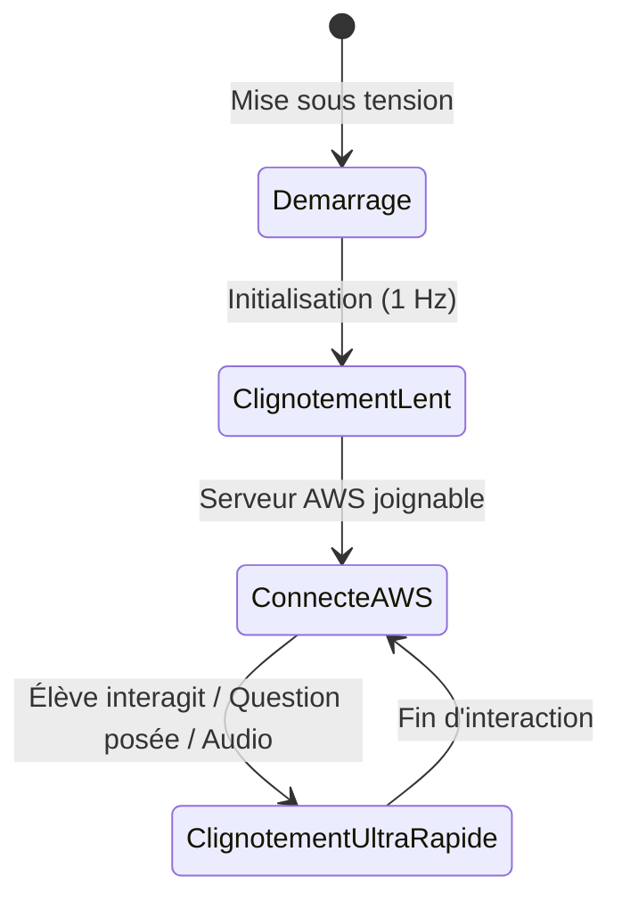

# 🇲🇱 AlternIA Box — Configuration & Guide Raspberry Pi 5 (8 Go RAM)

Ce dossier contient toute l'infrastructure matérielle et logicielle pour transformer un **Raspberry Pi 5 (8 Go de RAM)** en boîtier éducatif autonome (**Alta-Box**).

Le boîtier diffuse son propre réseau Wi-Fi **`Alta-box1`**, sert l'interface Kiosk en local avec mise en cache haute vitesse, relaie les requêtes IA vers le serveur AWS `t3.xlarge` (`https://api.alterniamali.com`), gère un retour lumineux d'activité par LED et prépare le câblage pour 4 boutons physiques, un microphone et un haut-parleur.

---

## 📋 Table des Matières

1. [Système d'Exploitation à Télécharger sur la Carte MicroSD](#1-système-dexploitation-à-télécharger-sur-la-carte-microsd)
2. [Flashage Pas-à-Pas avec Raspberry Pi Imager](#2-flashage-pas-à-pas-avec-raspberry-pi-imager)
3. [Installation en 1 Seule Commande](#3-installation-en-1-seule-commande)
4. [Réseau Wi-Fi Autonome (Alta-box1)](#4-réseau-wi-fi-autonome-alta-box1)
5. [Comportement Lumineux de la LED](#5-comportement-lumineux-de-la-led)
6. [Câblage Matériel : 4 Boutons + Micro + Haut-Parleur](#6-câblage-matériel--4-boutons--micro--haut-parleur)
7. [Supervision en Temps Réel dans le Portail Alta (Direction & Parents)](#7-supervision-en-temps-réel-dans-le-portail-alta)
8. [Services Systemd & Commandes Utiles](#8-services-systemd--commandes-utiles)

---

## 1. Système d'Exploitation à Télécharger sur la Carte MicroSD

Pour exploiter pleinement les **8 Go de RAM** et le processeur Quad-Core 64-bit du **Raspberry Pi 5**, vous devez **impérativement installer un OS 64-bit** :

| Choix | Version recommandée | Pourquoi ? |
| :--- | :--- | :--- |
| **Avec Écran Tactile branché** *(Recommandé)* | **Raspberry Pi OS (64-bit) with Desktop** *(Debian 12 Bookworm)* | Gère l'affichage graphique Kiosk plein écran avec Wayland/Labwc ultra-fluide. |
| **Sans Écran (Boîtier pur Wi-Fi / Headless)** | **Raspberry Pi OS Lite (64-bit)** *(Debian 12 Bookworm)* | Plus léger (~400 Mo), sans environnement de bureau, idéal si les élèves n'utilisent que leurs propres téléphones. |

> [!IMPORTANT]
> **Pourquoi Debian 12 Bookworm 64-bit ?**
> 1. Adresse nativement les **8 Go de RAM** sans limitation 32-bit.
> 2. Intègre `NetworkManager` pour une gestion ultra-stable du Hotspot Wi-Fi sans conflit.
> 3. Pilotes audio PipeWire/ALSA et GPIO modernes (`gpiod` / `gpiozero`).

---

## 2. Flashage Pas-à-Pas avec Raspberry Pi Imager

Le moyen le plus simple et fiable est d'utiliser l'outil officiel gratuit **Raspberry Pi Imager** :
👉 Téléchargement : [https://www.raspberrypi.com/software/](https://www.raspberrypi.com/software/)

1. Insérez votre carte MicroSD (recommandé : **32 Go ou 64 Go classe A2 / U3**) dans votre ordinateur.
2. Ouvrez **Raspberry Pi Imager** :
   * **Modèle de Raspberry Pi** : Choisissez **Raspberry Pi 5**.
   * **Système d'exploitation** : Cliquez sur *Raspberry Pi OS (64-bit)*.
   * **Stockage** : Sélectionnez votre carte MicroSD.
3. Cliquez sur **Suivant**. Une fenêtre vous demande d'appliquer les paramètres de personnalisation de l'OS (**Modifier réglages**) :
   * **Nom d'hôte (Hostname)** : `alta-box1`
   * **Nom d'utilisateur** : `ubuntu`
   * **Mot de passe** : `votre_mot_de_passe`
   * **Services** : Cochez **Activer SSH** (avec authentification par mot de passe).
4. Cliquez sur **Enregistrer**, puis confirmez l'écriture.
5. Une fois terminé, insérez la carte MicroSD dans le Raspberry Pi 5 et allumez-le.

---

## 3. Installation en 1 Seule Commande

Une fois connecté en SSH ou sur le terminal du Raspberry Pi 5 :

```bash
# 1. Cloner ou transférer le dossier AlternIA sur le Pi
cd ~
git clone https://github.com/votre-compte/AlternIA.git
cd AlternIA/raspberry-pi

# 2. Lancer le script d'installation tout-en-un
sudo ./setup_pi5_hotspot.sh
```

Le script configure automatiquement le Wi-Fi Hotspot, le routage IP, le cache Nginx, les démons de télémétrie, la LED et les services systemd auto-start.

---

## 4. Réseau Wi-Fi Autonome (Alta-box1)

Dès l'allumage du Raspberry Pi 5, le réseau Wi-Fi apparaît automatiquement :

* **Nom du Wi-Fi (SSID)** : `Alta-box1`
* **Mot de passe WPA2** : `Bamako+223`
* **Bande Wi-Fi** : `2.4 GHz` (canal 6, compatible avec 100% des smartphones au Mali)
* **Adresse IP de la passerelle Boîtier** : `10.42.0.1`

### Accès Wi-Fi pour les élèves (Portail Captif automatique) :
Dès qu'un élève se connecte au Wi-Fi `Alta-box1` depuis son téléphone ou sa tablette :
* **Redirection automatique** : La détection de portail captif (Android, iOS/Apple CNA, Windows) redirige automatiquement l'appareil vers **`https://device.alterniamali.com`**.
* Si l'élève tape manuellement `alta.box` ou `10.42.0.1` dans son navigateur, le serveur Nginx Edge renvoie immédiatement un code 302 vers **`https://device.alterniamali.com`**.
* En cas de coupure Internet totale, un miroir local de secours (`/local/` ou `127.0.0.1`) permet la continuité pédagogique sans écran noir.

### Sortie Vidéo HDMI (Écran TV / Kiosk Kiosque) :
Dès le branchement du Raspberry Pi 5 sur une télévision ou un moniteur HDMI :
* Le service systemd `alta-kiosk.service` exécute le script `kiosk/launch_kiosk.sh`.
* Chromium démarre en plein écran (**mode Kiosk 1080p**) directement sur **`https://device.alterniamali.com`**.
* L'option `--autoplay-policy=no-user-gesture-required` garantit la diffusion vocale immédiate des réponses sans nécessiter de clic préalable.

---

## 5. Comportement Lumineux de la LED

Le script [`agent/led_indicator.py`](file:///Users/ibrahimsorydiallo/Desktop/OSC/AlternIA/raspberry-pi/agent/led_indicator.py) pilote la LED d'activité du Pi 5 (et/ou une LED externe sur GPIO 17) :



* **🟡 Clignotement lent (1 Hz)** : Le boîtier démarre, configure le réseau et recherche la liaison avec le serveur AWS.
* **🟢 Lumière stable / Battement doux** : La liaison avec le serveur AWS (`https://api.alterniamali.com`) est confirmée opérationnelle.
* **🔵 Clignotement ultra-rapide ininterrompu** : Des élèves sont connectés et effectuent des requêtes, posent des questions ou interagissent avec le tuteur vocal !

---

## 6. Câblage Matériel : 4 Boutons + Micro + Haut-Parleur

Le contrôleur matériel [`hardware/buttons_audio_controller.py`](file:///Users/ibrahimsorydiallo/Desktop/OSC/AlternIA/raspberry-pi/hardware/buttons_audio_controller.py) est déjà pré-câblé pour recevoir vos composants physiques :

### Broches GPIO (Pinout Raspberry Pi 5) :

| Composant | Broche BCM | Broche Physique | Raccordement électrique |
| :--- | :---: | :---: | :--- |
| **Bouton 1 (Micro Push-to-Talk)** | **GPIO 5** | Pin 29 | Une patte sur GPIO 5, l'autre sur GND (Pin 30) |
| **Bouton 2 (Répéter Réponse Audio)** | **GPIO 6** | Pin 31 | Une patte sur GPIO 6, l'autre sur GND (Pin 34) |
| **Bouton 3 (Changer de Classe)** | **GPIO 13** | Pin 33 | Une patte sur GPIO 13, l'autre sur GND (Pin 39) |
| **Bouton 4 (Défi Quizz National)** | **GPIO 19** | Pin 35 | Une patte sur GPIO 19, l'autre sur GND (Pin 39) |
| **LED d'État Externe (Optionnelle)** | **GPIO 17** | Pin 11 | Anode (+) via résistance 330Ω sur GPIO 17, Cathode (-) sur GND |

> [!TIP]
> Tous les boutons utilisent les **résistances de Pull-Up internes du Raspberry Pi 5**. Vous n'avez pas besoin d'ajouter de résistances externes pour les boutons : reliez simplement une patte au GPIO et l'autre à la masse (GND) !

### Microphone & Haut-Parleur :
* **Microphone** : 
  * Brancher un microphone USB standard sur l'un des ports USB du Pi 5 (ou carte d'extension I2S / USB audio Jack).
* **Haut-Parleur** :
  * Brancher une enceinte Jack sur un adaptateur USB-Audio DAC, ou un module I2S DAC (type **MAX98357A**).

### Tester le matériel en direct :
```bash
python3 /home/ubuntu/AlternIA/raspberry-pi/hardware/test_hardware.py
```
Ce script émet un son de test, enregistre votre voix pendant 3 secondes et détecte l'appui sur chaque bouton en affichant un message coloré dans le terminal.

---

## 7. Supervision en Temps Réel dans le Portail Alta

L'agent [`agent/box_heartbeat.py`](file:///Users/ibrahimsorydiallo/Desktop/OSC/AlternIA/raspberry-pi/agent/box_heartbeat.py) transmet toutes les 30 secondes un battement de cœur à votre serveur AWS :

* **Dans le Portail Direction / Établissement** (`https://admin.alterniamali.com/etablissement/supervision-boitiers`) :
  * Le boîtier `Alta-box1` apparaît avec son statut **En ligne**, son IP (`10.42.0.1`), son nombre d'élèves connectés et la température de son CPU.
* **Dans l'Espace Parent** (`https://admin.alterniamali.com/parent/boitier`) :
  * Le parent voit l'état de synchronisation en direct et la disponibilité de la Box.

---

## 8. Services Systemd & Commandes Utiles

Tous les composants sont gérés par systemd avec redémarrage automatique garanti :

```bash
# Vérifier l'état de tous les services du Boîtier
sudo systemctl status alta-hotspot alta-agent alta-led alta-hardware

# Voir les logs de télémétrie transmis au serveur AWS
sudo journalctl -u alta-agent -f

# Voir les logs du contrôleur LED
sudo journalctl -u alta-led -f

# Voir le nombre d'élèves actuellement connectés au Wi-Fi
sudo iw dev wlan0 station dump | grep Station | wc -l
```
